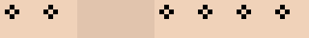

# C06：保留源图细节、按需读取的视觉旁路

本实验只验证源图旁路的存储与恢复。未使用 Qwen 特征、未训练镜像解码器或分层 Attention。所有场景均为原始程序化数据，语义向量明确标记为 SYNTHETIC。

## 三种“不压缩”分别意味着什么

|要求|本原型的实际行为|
|---|---|
|不丢弃原始信息|完整 patch 库和粗图+精确残差逐像素还原；粗图单独有损。|
|不减少进入主干的 Token|与无损保存独立。这里保留库中全部像素，仅在接口上选 ROI；未运行真实主干。若要求全部原始 patch 每次进入主干，不能把选区读取当成同一要求。|
|不降低全部位置计算成本|本原型没有实现或验证这种约束。选区可少读数据，不能同时声称已经对所有位置执行完整视觉计算。|

## 表示与存储账本

A：RGB 经 zero-padding、reshape、transpose 变成 [N,T,T,3]。逆排列后裁去已知补齐区；没有池化、插值或降维。坐标以每块4个 uint32 保存。文件为12字节前缀、完整JSON头、坐标表和未压缩像素系数。

B：每8×8有效区域取整数 floor mean，边界只计算有效像素。R=int16(X)-int16(expand(C))；恢复 X=expand(C)+R。粗图是有损摘要，残差完整保存。系数、坐标、padding、dtype、manifest 全部计费；没有熵编码或无损压缩率宣称。

|场景|源RGB字节|仅粗图+元数据字节|原始patch总字节|粗图+精确残差总字节|粗图MAE|精确路径最大误差|
|---|---:|---:|---:|---:|---:|---:|
|desktop_1537x1025_v0|4726275|104000|4993499|10064941|2.258059|0|
|desktop_1537x1025_v1|4726275|104000|4993499|10064941|2.257912|0|
|desktop_1023x769_v0|2360061|51710|2470602|4979930|3.474336|0|
|desktop_1023x769_v1|2360061|51710|2470602|4979930|3.474041|0|

各 bank 的 header、坐标表、有效系数、补齐字节和 dtype 均在 RESULT.json 单列。语义 .npy 的128字节格式头、向量256字节及 semantic.json、source_handle.json 也单列；上表只计算对应图像表示，不把语义向量偷偷并入/排除一种对照。

## 区域读取的真实测量

坐标为源图像素的半开区间(x0,y0,x1,y1)。Reader 根据坐标算相交块，只 seek/read 所需坐标项和块数据；不 mmap、不预先读取整个payload。跨块会多读边缘，重叠 ROI 在同一 read_many 调用内共用块；跨调用不保留缓存。只统计实际 file.read 返回字节，包含每个新 reader 的头和manifest，不等同于物理磁盘I/O。

|场景/目标|目标占比|输出RGB字节|仅粗图读取字节|原始patch读取字节|粗图+残差读取字节|粗图局部MAE|精确路径最大误差|
|---|---:|---:|---:|---:|---:|---:|---:|
|desktop_1537x1025_v0/tiny_glyph|0.00400%|189|768|12555|25629|78.5397|0|
|desktop_1537x1025_v0/one_pixel_lines|0.10150%|4797|1088|27995|56749|15.1240|0|
|desktop_1537x1025_v0/eyes_open|0.00812%|384|576|3291|6957|25.1875|0|
|desktop_1537x1025_v0/accessory_square|0.00406%|192|576|3291|6957|19.7500|0|
|desktop_1537x1025_v0/odd_edge|0.00159%|75|768|12555|25629|45.4933|0|
|desktop_1537x1025_v1/tiny_glyph|0.00400%|189|768|12555|25629|74.3598|0|
|desktop_1537x1025_v1/one_pixel_lines|0.10150%|4797|1088|27995|56749|15.1240|0|
|desktop_1537x1025_v1/eyes_closed|0.00812%|384|576|3291|6957|25.1875|0|
|desktop_1537x1025_v1/accessory_clip|0.00406%|192|576|3291|6957|19.7500|0|
|desktop_1537x1025_v1/odd_edge|0.00159%|75|768|12555|25629|45.4933|0|
|desktop_1023x769_v0/tiny_glyph|0.00801%|189|766|12554|25626|78.5397|0|
|desktop_1023x769_v0/one_pixel_lines|0.20326%|4797|1086|27994|56746|15.3942|0|
|desktop_1023x769_v0/eyes_open|0.01627%|384|574|3290|6954|25.1875|0|
|desktop_1023x769_v0/accessory_square|0.00814%|192|574|3290|6954|19.7500|0|
|desktop_1023x769_v0/odd_edge|0.00318%|75|638|6378|13178|53.8400|0|
|desktop_1023x769_v1/tiny_glyph|0.00801%|189|766|12554|25626|74.3598|0|
|desktop_1023x769_v1/one_pixel_lines|0.20326%|4797|1086|27994|56746|15.3942|0|
|desktop_1023x769_v1/eyes_closed|0.01627%|384|574|3290|6954|25.1875|0|
|desktop_1023x769_v1/accessory_clip|0.00814%|192|574|3290|6954|19.7500|0|
|desktop_1023x769_v1/odd_edge|0.00318%|75|638|6378|13178|53.8400|0|

所有 fixed target 均小于图像1%；小字形是硬编码3×5笔画，细线1像素，眼睛/附件有成对几何变化。比较图每行从左到右：源图、仅粗图、粗图+残差、完整patch；采用整数重复放大以便看清像素。全部固定场景与全部目标均提供，未挑选样本。

## 边界与重叠证据

|场景/路径|跨块/奇数/重叠一致|合并请求读取字节|逐个请求字节|合并节省字节|
|---|---|---:|---:|---:|
|desktop_1537x1025_v0/raw|逐像素一致|37259|40956|3697|
|desktop_1537x1025_v0/coarse_residual|逐像素一致|75421|83844|8423|
|desktop_1537x1025_v1/raw|逐像素一致|37259|40956|3697|
|desktop_1537x1025_v1/coarse_residual|逐像素一致|75421|83844|8423|
|desktop_1023x769_v0/raw|逐像素一致|31082|34776|3694|
|desktop_1023x769_v0/coarse_residual|逐像素一致|62970|71384|8414|
|desktop_1023x769_v1/raw|逐像素一致|31082|34776|3694|
|desktop_1023x769_v1/coarse_residual|逐像素一致|62970|71384|8414|

除上述证据外，还执行1024次高分辨率随机ROI一致性检查、uint8/int8/uint16/int16/int32/uint32/int64/uint64的pack往返（含非连续视图、uint64极值）、单像素/小于块/奇数尺寸、空ROI、非法ROI、损坏坐标及截断文件、语义身份误配检查。单元测试记录见outputs/TEST_LOG.txt。

眼睛开/闭以及附件方块/横条在对应8×8区域的粗表示完全相同，而源像素不同（RESULT.json给出断言）。因此粗表示单独不存在唯一恢复；精确恢复来自残差/原图，不能来自“更聪明的上采样”这一假设。

## 与真实视觉特征实验分栏

|对照|源RGB/残差可读|语义输入|本次实际结果|
|---|---|---|---|
|仅粗图|仅粗摘要|无|局部与全图误差见上表，有信息碰撞。|
|粗图+残差|是|无|本次全部测试逐像素一致。|
|完整patch库|是|可独立挂合成向量|本次全部测试逐像素一致。|
|只用真实Qwen视觉特征的镜像模型|否|真实Qwen特征|未运行；不得由旁路结果推断。|
|纯文字生图|不存在源图|文字条件|本旁路不可用；未运行。|

## Token、读取与计算账本

以最大场景为例，32×32存储块并不等于Qwen token；源块数量与8×8粗图像素数可以计算，但未测量Qwen tokenizer。合成语义输入固定4×16 float32，完全随机；它不是Qwen、不是语义能力证据，也未被送入主干。

源库不删像素；ROI读取仅返回被请求的源像素及相交块。未来可先把语义摘要送给主干，再根据问题产生ROI，将选区另行编码。这样能减少进入主干的数据量和部分计算，但不等于“全部位置计算量不变”，也不保证端到端更快。这里用已知目标坐标演示按需读取，未实现自然语言定位器。

## 执行和边界

实测数值运行墙钟 1.834 秒，进程CPU 1.889 秒；Linux CPU亲和性限制为2个CPU，数值线程上限2，观察到2个线程。环境与执行URL见RESULT.json。打包总耗时、zip字节和SHA256见PACKAGE.json。

所有耗时仅单次CPU样本，不是吞吐基准；没有GPU、模型权重、付费API或训练。检测到桌面命令运行器为Mac后停止使用；未读取本机文件或模型缓存，实验在GitHub Actions隔离Linux运行。依赖只使用NumPy与Python标准库，在venv内优先尝试现有NumPy，缺失时只安装公开二进制wheel。

## 最值得接入主实验的接口

接入 read_details(handle, directory, rois, expected_rgb_sha256) -> (RGB crops, IO statistics)。先保存 source_shape/dtype、源RGB哈希、raw_bank句柄及语义摘要的独立句柄；ROI必须映射回源图像素坐标。主实验重建对照显式标注 has_source_bypass，把 feature_only 与 feature_plus_source 分栏，旁路关闭时不能静默读取源图。语义张量以后替换为真实Qwen输出，不改变原始库；生产接入需补充真实resize/crop坐标变换、视频帧ID/版本、授权及多请求缓存。
