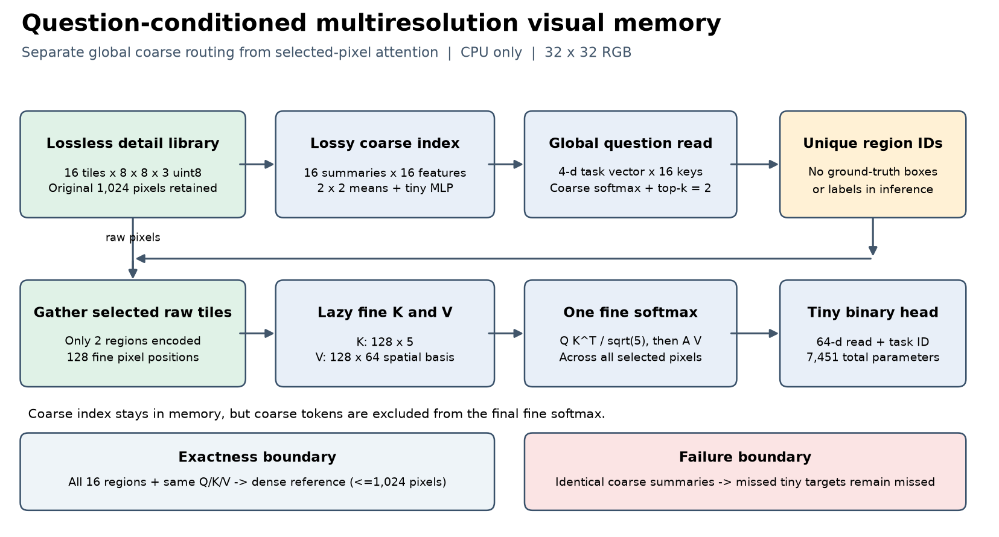

# 问题驱动的多分辨率视觉记忆

这是独立的 CPU 机制原型。它把全局粗粒度路由和选中区域的细粒度 Attention 分成两次计算，保留原始像素库，并直接暴露粗摘要漏掉小目标时的失败。模型只有 7,451 个参数，未加载 Qwen 或其他预训练大模型。



## 运行小演示

依赖是 Python、PyTorch、NumPy 和 Pillow。所有计算固定在 CPU，数值库最多使用 2 个计算线程，PyTorch interop 为 1；不探测或初始化 MPS、CUDA、DCU。已有环境可用 `LAB_PYTHON` 指定解释器。

```sh
sh run.sh demo
sh run.sh demo --question 2 --k 2 --method learned
sh run.sh demo --image data/images/test_blind/test_blind_0000.png --question 0 --k 2
sh run.sh test
```

模型、原始 PNG、固定测试答案和逐问题结果已经包含在目录中，演示不需要联网或重新训练。`demo.html` 是可离线打开的结果查看器，可以切换问题、预算和路由对照；其结果由 Python 的实际 Attention 计算预先生成，浏览器不执行模型。GitHub 上需要下载本目录后打开 HTML。

如需从生成器重跑：

```sh
sh run.sh all
```

已有固定数据和模型会保留；`all` 不会覆盖它们或再次训练。`train.py` 使用持久预算账本累计训练时间，最多 1,200 秒，每次最多预留 180 秒。首次训练累计约 1.76 秒。记录见 `results/training_budget.json`。重新训练应在复制出来的实验目录里明确移走其 `model.pt`，保留训练预算账本；无需重新训练即可复查交付。

## 应先看什么

| 内容 | 入口 |
|---|---|
| 机制、固定测试、真实成本和限制 | [REPORT.md](REPORT.md) |
| 原文与官方实现核查 | [SOURCE_MAP.md](SOURCE_MAP.md) |
| B 会话交接与数组协议 | [exchange/HANDOFF.md](exchange/HANDOFF.md)、[protocol.json](exchange/protocol.json) |
| 所有预算与所有路由对照 | [metrics.json](results/metrics.json)、[per_question.jsonl](results/per_question.jsonl) |
| 原图与答案分离 | `data/images/`、`data/inputs/`、`data/annotations/` |
| 最小实现 | [memory.py](memory.py)、[model.py](model.py)、[demo.py](demo.py) |
| 1920×1080 真实图像分块 | [high_resolution.json](results/high_resolution.json)、`data/earth_detail_blocks.npz` |
| 完成后发布的交接标记 | [exchange/READY.json](exchange/READY.json) |

## 三件不同的事

| 问题 | 本原型实际做到什么 |
|---|---|
| 是否丢弃原始数据 | 不丢弃。uint8 RGB 原像素可按 reshape 和 permutation 精确还原，padding 有独立有效性掩码。 |
| 进入计算主干的表示是否完全不压缩 | **不是。**粗摘要是有损均值；主干先读粗表示，只在选中的区域读细位置。保存原图不能证明主干表示无损。 |
| 是否对全部位置执行相同的昂贵计算 | **不是。**所有区域都付出摘要和索引成本，只有选中区域付出细特征编码与细 Attention 成本。 |

这只是受监督的图标任务：四维 one-hot 任务向量对应眼睛、手臂、标记、连接，不能据此称为理解自然语言。全选区域且 Q/K/V 定义相同时才能要求与 dense 参考数值一致。部分选择不保证等价，漏检和输出误差都保存在结果里。合成场景成绩不代表真实桌面质量。

原型未接入既有 P2 或 B 代码，也未实现完整 Qwen、DeepSeek CSA2、ZoomEye 或 LLaVA-UHD。GPU/DCU/MPS 性能未知。CPU 时间显示，小问题中路由开销可以超过节省的 Attention 时间，详见报告。

## 文件生成与许可

`generate_data.py` 只负责保存原图和离线监督，推理不导入它。`train.py` 只打开 train 与 train_blind 文件，测试答案只由评测器读取。`evaluate.py` 保存固定集合与 CPU 计时；`build_artifacts.py` 生成交接数组、图和离线查看器，额外需要 Matplotlib；`fetch_sources.py` 仅抓取参考代码与 NASA 原图，不属于离线演示路径。`write_report.py` 从结果生成报告。

自写代码与合成数据遵循仓库 MIT 许可。官方代码、论文和 NASA 图像的来源及各自条件见 [THIRD_PARTY_NOTICES.md](THIRD_PARTY_NOTICES.md)。
