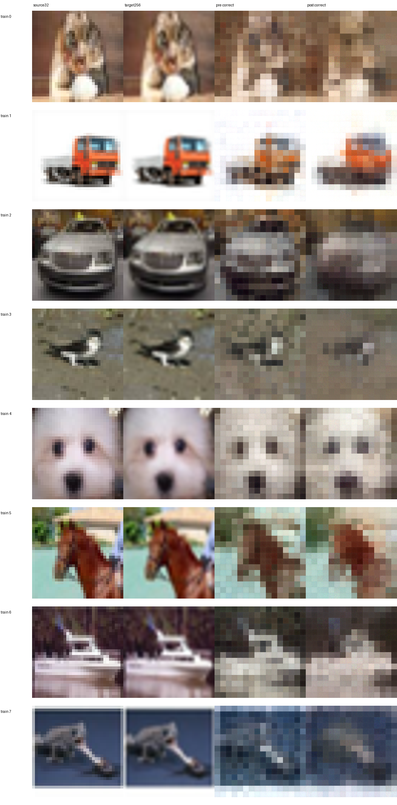
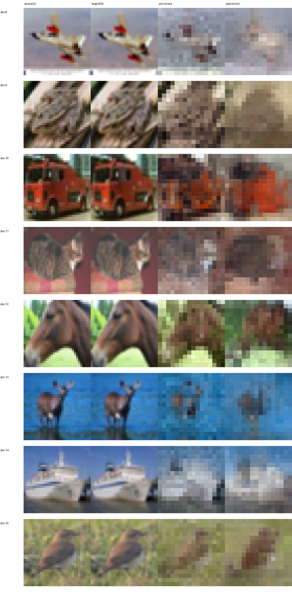

# 固定 pre/post 直观诊断

使用既有的 16 份配对接口样本：8 张 train、8 张 dev，没有 final。两个浅层模型的 best 参数冻结，只做正确特征输入推理；不更新参数、不重新提取编码器特征、不用于配置选择。

这是完整 1,000/200 数值对照的可视化补充，不用这 16 张图代替全量指标。其逐图 MSE 与正式评估记录的最大差异仅约 `3.73e-9`，见 [复核记录](REPLAY_CONSISTENCY.json)。

图列：原始32图（最近邻放大） / 官方256目标 / pre正确重建 / post正确重建。PNG 仅显示时裁剪到 `[0,1]`；原生精度未裁剪预测在 Release 补充 ZIP 中。

