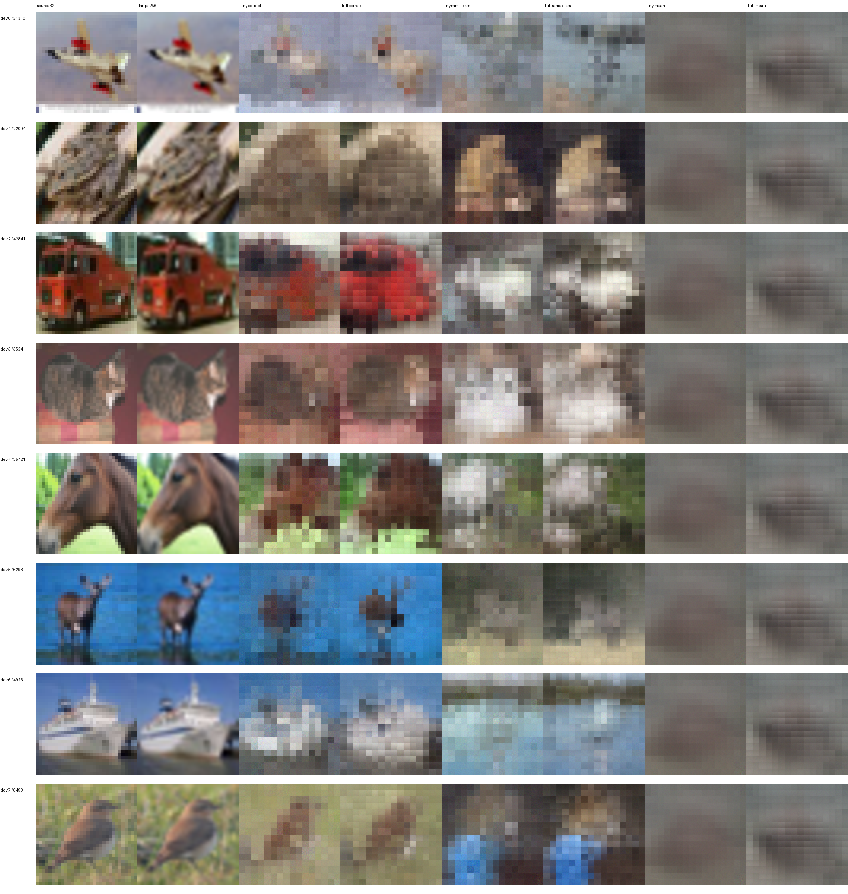
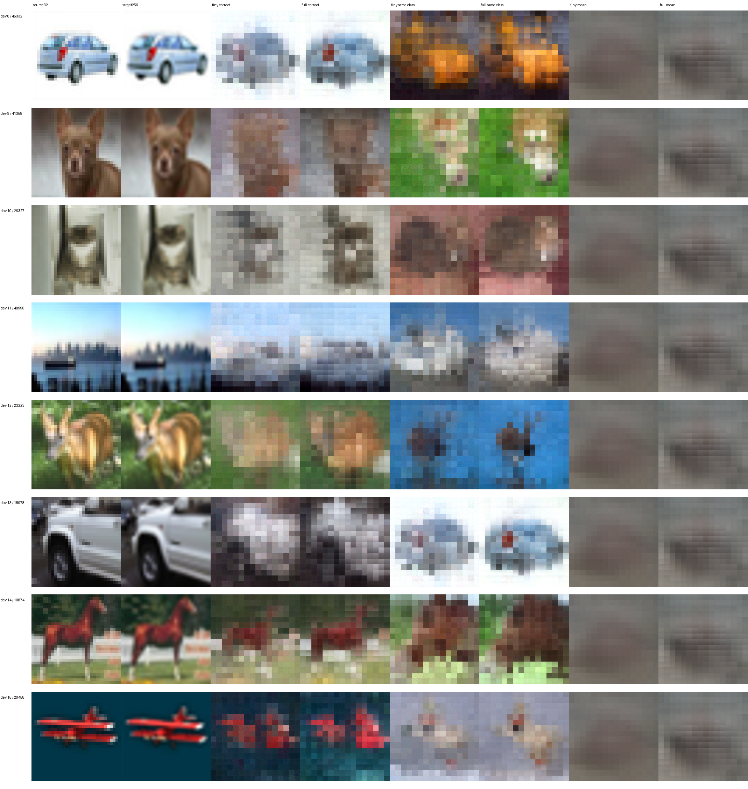
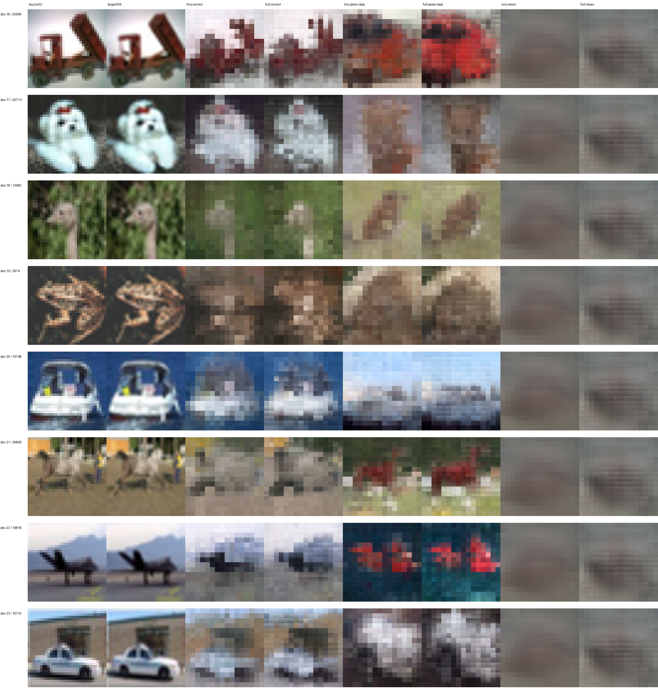
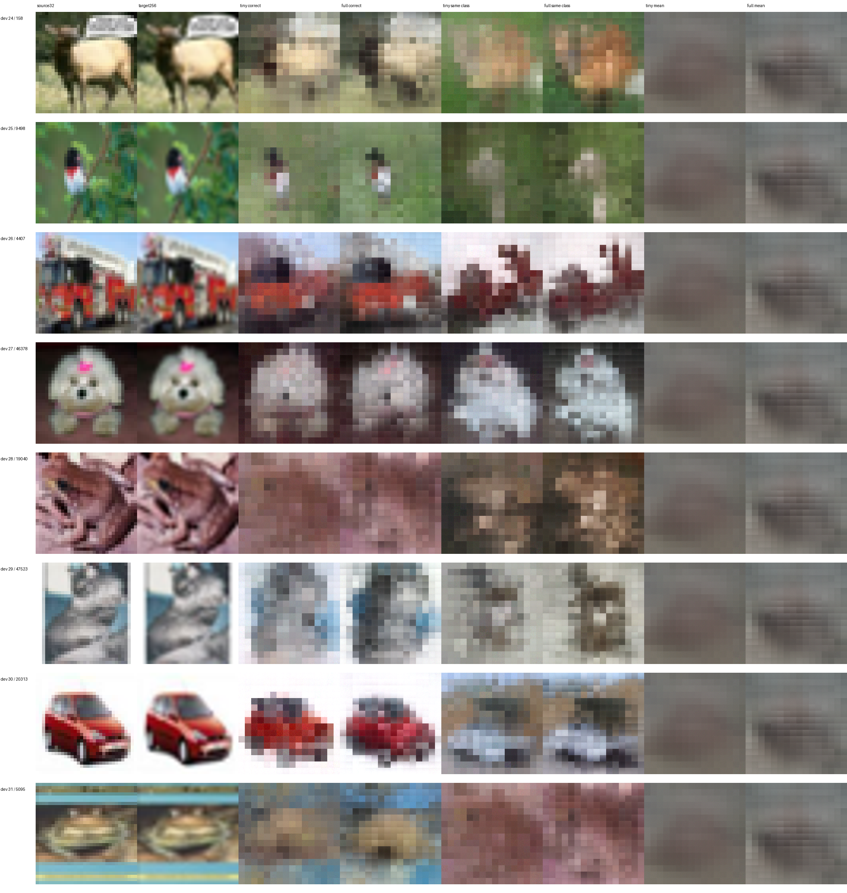
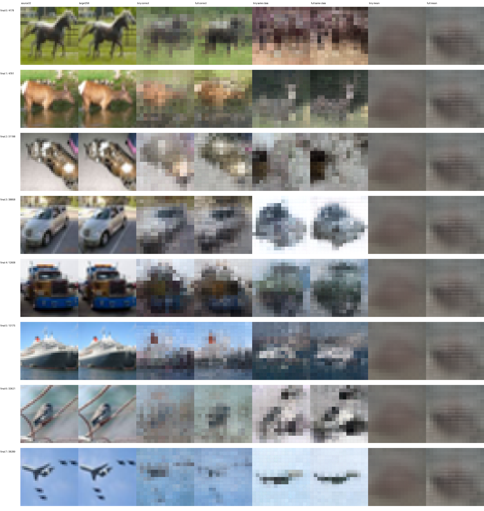
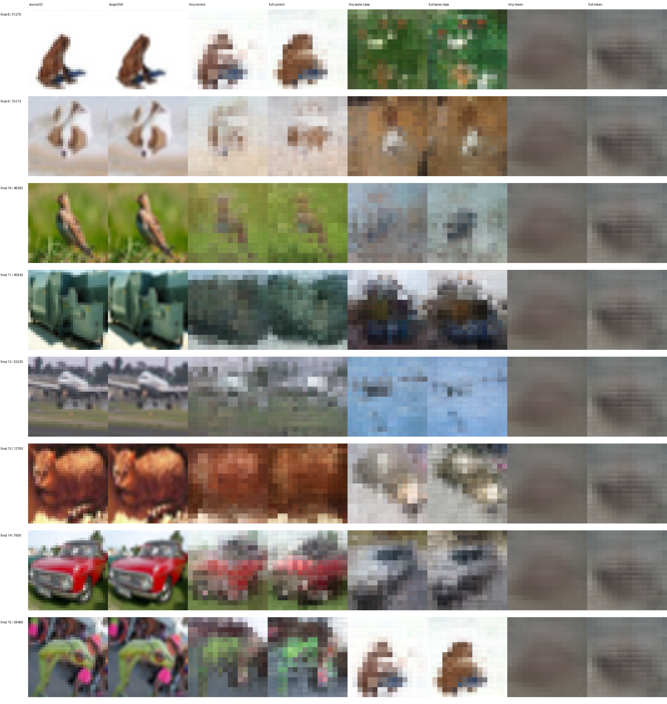
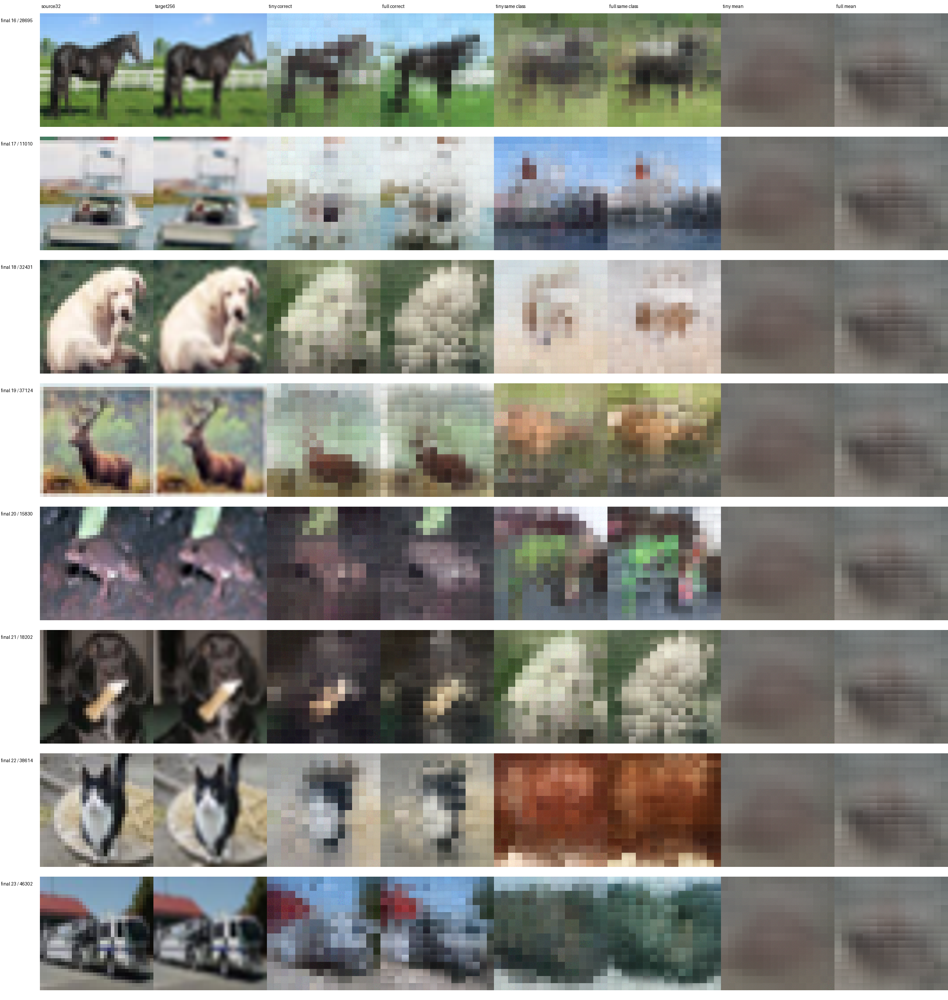
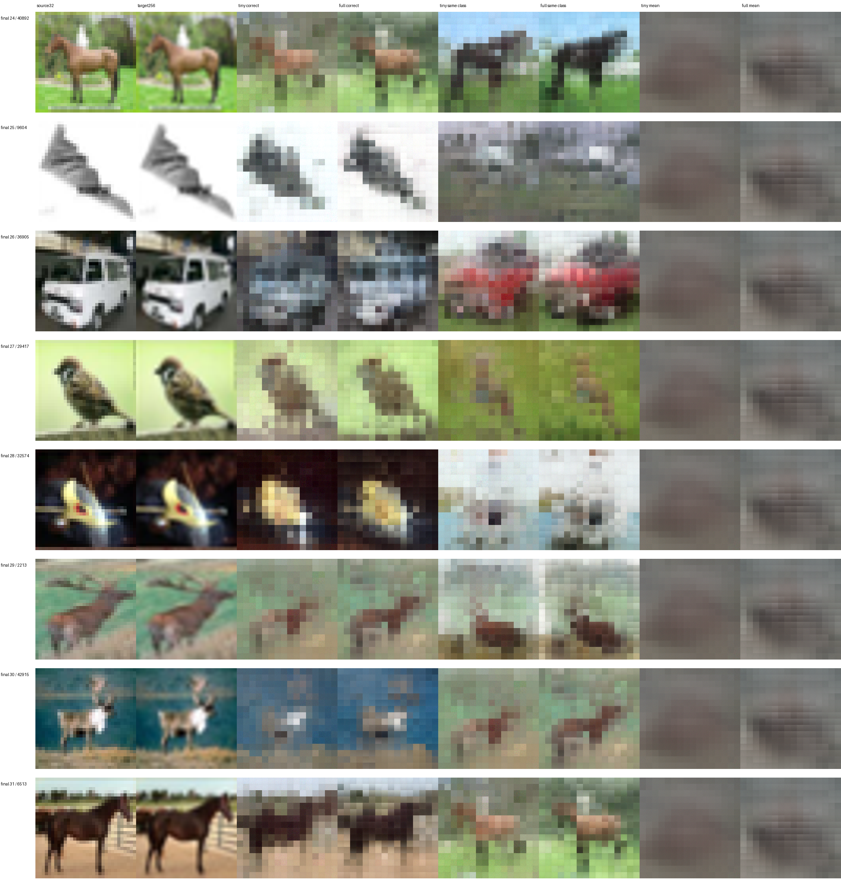
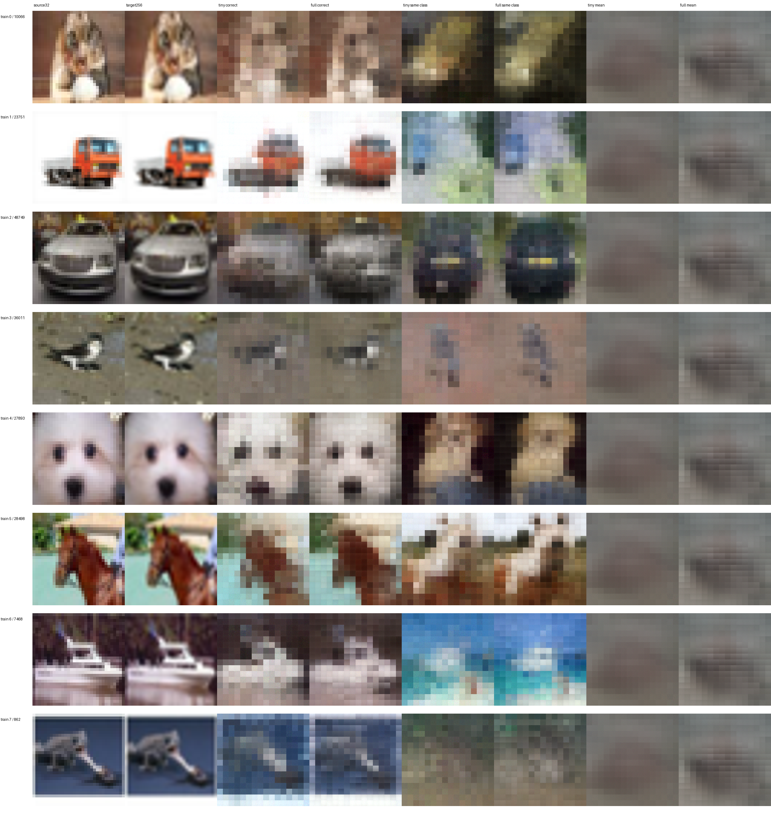
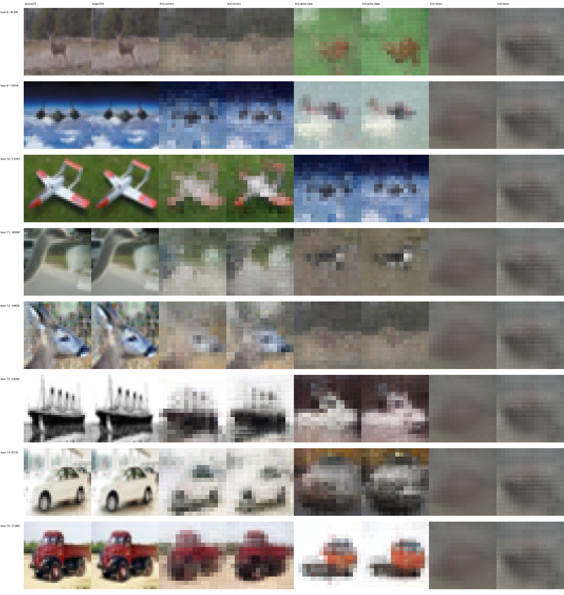

# 夜间 Qwen 视觉镜像重建实验

1. full 是否真正跑了：已完成正式训练
2. 比 tiny 怎样：final MSE：full 0.021108，tiny 0.022460；full 相对 tiny 变化 -6.02%（负数更低）
3. 能否泛化：full 在本轮 final 优于固定训练均值图。不声称历史上从未使用这些图，也不外推到任意图像。
4. pre/post 说明什么：同一 1000/200 子集 dev MSE：pre 0.007980，post 0.023019；共享浅层主干，但 post 适配器多 3,148,800 参数，不是绝对完美控制变量，不能单凭差值证明信息不可恢复。
5. 语言接口是否运行：NOT_RUN：Provider lease has less than 60 minutes remaining after main reconstruction; official language weights were not downloaded or instantiated

本轮在正式训练前按最初含冷启动的吞吐探针保守回退到2000张训练图。此探针没有单独排除首次初始化开销，因此不能据此证明充分预热后10000张不可行；没有根据重建分数改选数据。
## 主实验像素指标

| 方法 | split | MSE | MAE | 均值图 MSE | 下采样32对原图 MSE | 梯度 MAE | 边界梯度 MAE |
|---|---|---:|---:|---:|---:|---:|---:|
| mirror_tiny | train | 0.013542 | 0.086544 | 0.059756 | 0.013750 | 0.019896 | 0.056429 |
| mirror_tiny | dev | 0.021880 | 0.110701 | 0.056375 | 0.022193 | 0.019670 | 0.056976 |
| mirror_tiny | final | 0.022460 | 0.111447 | 0.063081 | 0.022770 | 0.019926 | 0.057969 |
| mirror_full | train | 0.008555 | 0.068034 | 0.059756 | 0.008752 | 0.015531 | 0.053420 |
| mirror_full | dev | 0.020566 | 0.106081 | 0.056375 | 0.020999 | 0.015584 | 0.056288 |
| mirror_full | final | 0.021108 | 0.106977 | 0.063081 | 0.021540 | 0.015738 | 0.056819 |

目标是官方预处理后的 256×256 RGB [0,1]，来自32×32源图插值；没有获得源图不存在的细节。历史32×32线性/MLP结果不参与本轮公平排名。

训练/开发/最终评估图数：2000 / 500 / 500。共同正式步数 16300，有效batch32。MSE单一主损失，AdamW lr3e-4、wd1e-4、5%warmup、cosine、clip1。

tiny 为2层/256宽/4头/FFN1024；full 为12层/768宽/12头/FFN3072。两者随机初始化，使用相同训练顺序、目标和训练集特征统计，位置为固定二维sin/cos，不声称是对官方RoPE的求逆。

真实forward_pre_hook捕获merger之前张量；官方视觉塔及merger始终eval、冻结，不加载P2失败权重或运行语言主干。

每个模型使用dev选择best；全部配置与共同步数在正式训练前锁定，final在主模型训练和选择完成后才打开。正确/同类错配/平均特征的全部MSE、MAE和辅助诊断见 results/metrics.json。

固定图册覆盖全部预定 train16、dev32、final32，不挑最好图。PNG只作[0,1]裁剪显示；对应未裁剪原生精度预测保存为 *_unclipped.safetensors。

梯度和patch边界误差仅为辅助诊断，不等同于感知质量或语义理解。pre/post适配器参数不同，差值不等于merger信息损失的精确因果测量。

用户预算上限8小时；实际资源为90分钟免费课堂，因此训练预算还受到实例寿命约束。旧账本未修改；有限修复保留原时间起点、样本、步数与检查点。远端自行计时/退出，本机未使用MPS。

best/last/config/normalization/optimizer-RNG状态按不可变目录原子保存；每个READY记录文件哈希。paired feature_evidence中8训练+8开发，无final。完整源模型和全量特征/数据缓存不对外重复分发。

模型与数据来源：Qwen/Qwen3.5-0.8B revision 2fc06364715b967f1860aea9cf38778875588b17；Transformers5.2.0；CIFAR10官方训练池，保留原45000/5000划分，官方test从未打开。

## 固定图册

